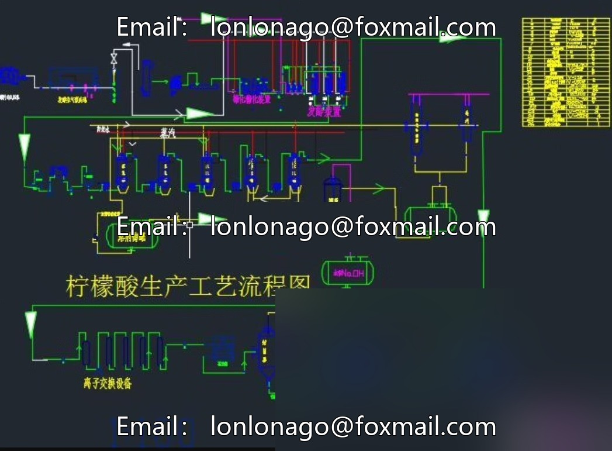
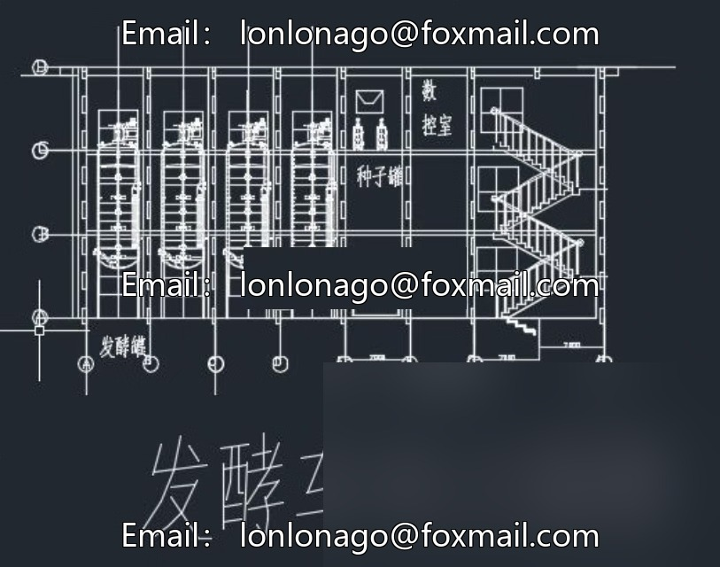
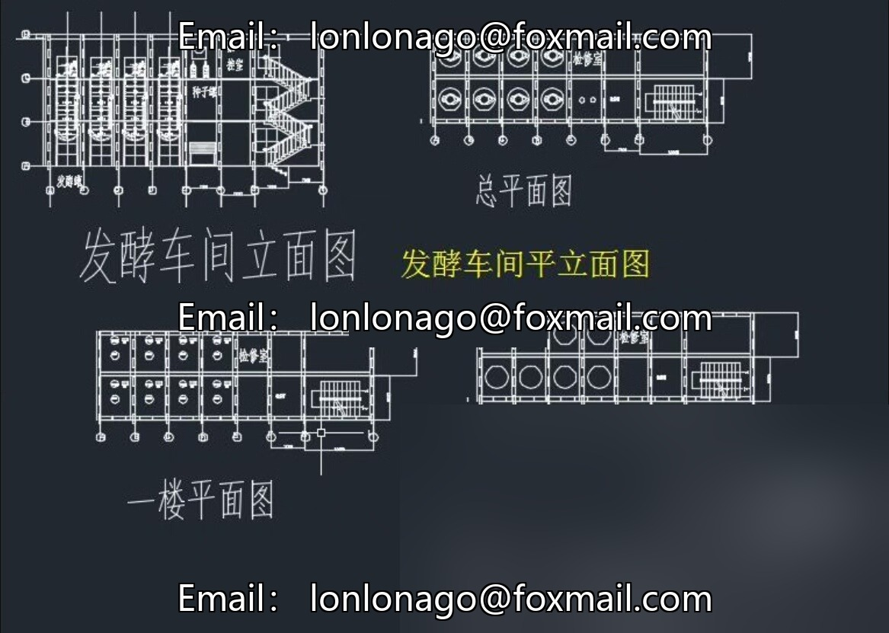
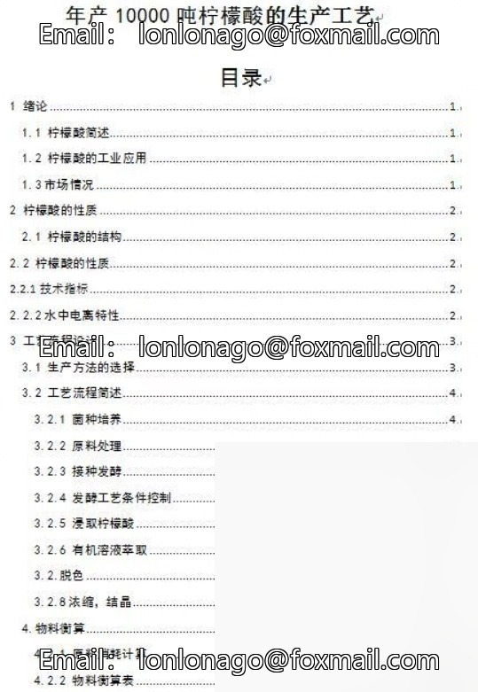

# Lemonic acid process design; Lemonic acid process design; Lemonic acid process design.

## Body

Citric acid process design, Citric acid process design diagram, Citric acid process design CAD diagram, production process design of 10,000 tons per year of citric acid, production process of 10,000 tons per year of citric acid

The design includes lemon acid production process design, CAD drawings, an annual production of 10,000 tons of lemon acid process, fermentation workshop floor and elevation views, and plane and total layouts.

<!-- AI_ENRICHED -->

## Images

## Payment

Here is a pay link on Stripe ( https://buy.stripe.com/3cs8yP7sY87d0vu9AB ). Please contact me lonlonago@foxmail.com after funding $89, and I will send you a complete data files , thank you!

